
While I cannot claim which direction the causality goes, completing a video game 100% and publishing an academic paper share striking parallels. Both require resilience (gamers: challenging levels, researchers: overcoming rejections), patience (gamers: unlocking achievements, researchers: rewriting and revising), attention to detail (gamers: complex mechanics, researchers: precise writing), and the ability to learn from setbacks (gamers: adapting strategies after failure, researchers: incorporate feedback).

Below is a list of games I have completed to absolute perfection on Nintendo Switch. You will notice a pattern of game titles that scream nostalgia. My gaming name is DoctorIw, a name I chose when becoming a doctor was still a distant dream.

  <h2 align="center">Pokémon games</h2>
  

    

      

        
        
Pokémon Scarlet Paldea Pokédex

      

    
    
Pokémon Scarlet Kitakami Pokédex

    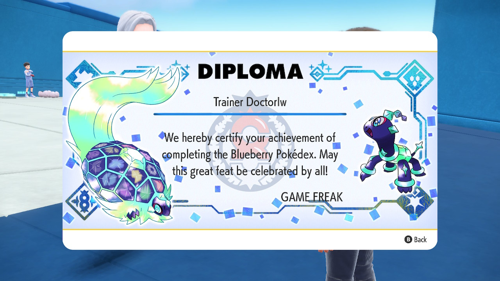
    
Pokémon Scarlet Blueberry Pokédex

    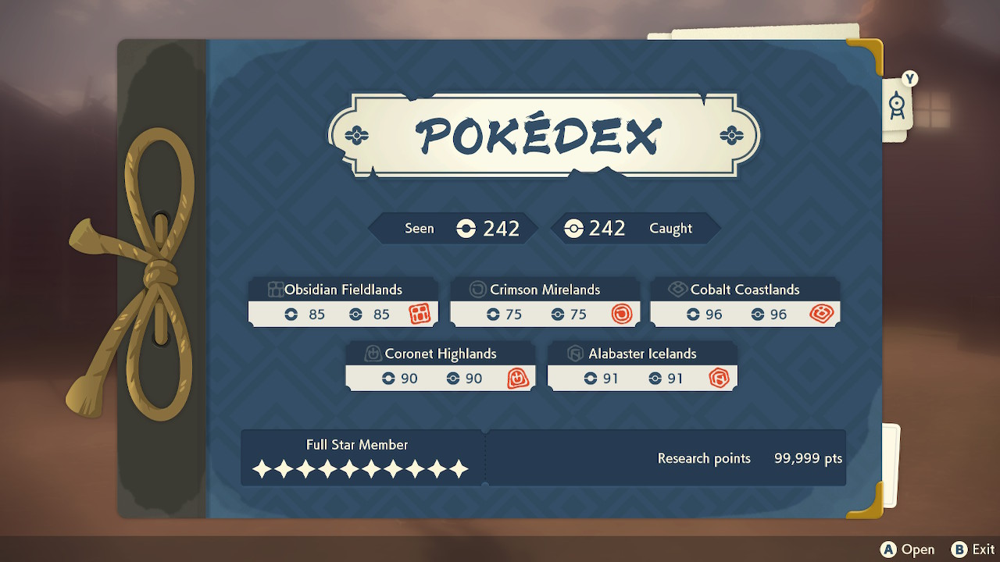
    
Pokémon Arceus Pokédex

    
    
Pokémon Shield Galar Pokédex

    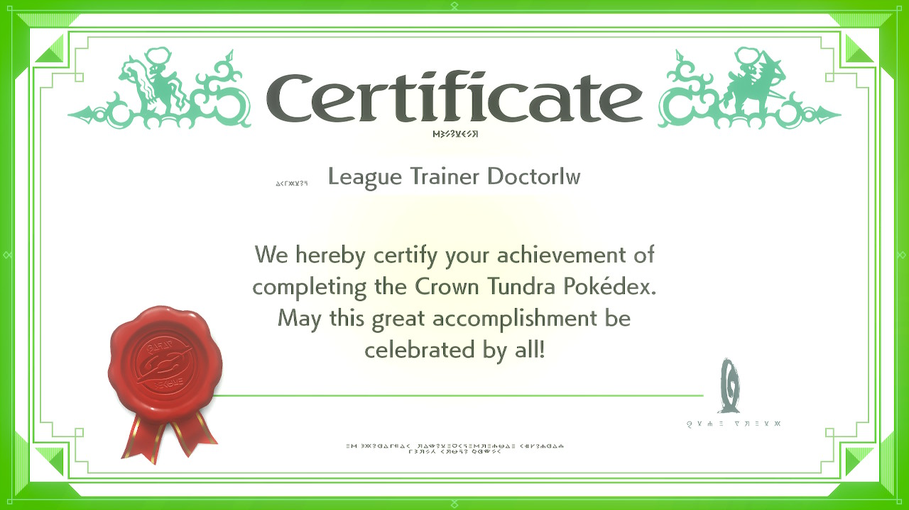
    
Pokémon Shield Tundra Pokédex

    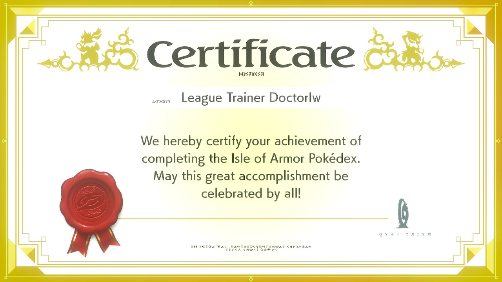
    
Pokémon Shield Armor Pokédex

    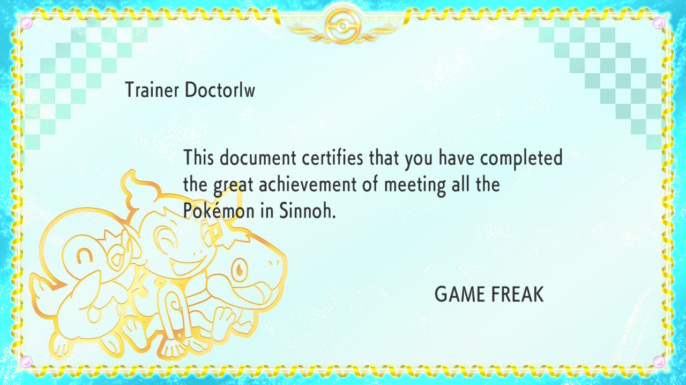
    
Pokémon Brilliant Diamond Sinnoh Pokédex

    
    
Pokémon Brilliant Diamond National Pokédex

    
    
Pokémon Let's Go Pikachu Pokédex

    

    <button class="prev" onclick="moveCarousel('carousel1', -1)">&#10094;</button>
    <button class="next" onclick="moveCarousel('carousel1', 1)">&#10095;</button>
  

  <h2 align="center">Platform Games</h2>
  

    

    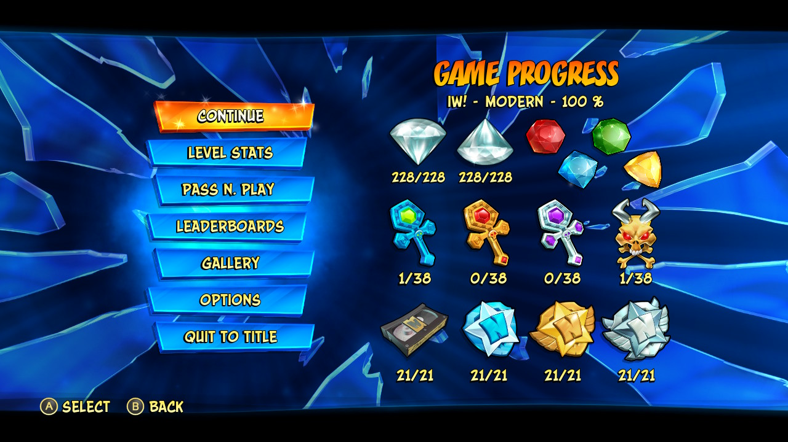
    
Crash Bandicoot 4: It's About Time

    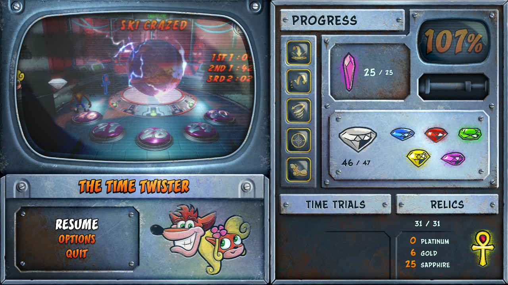
    
Crash Bandicoot 3: Warped

    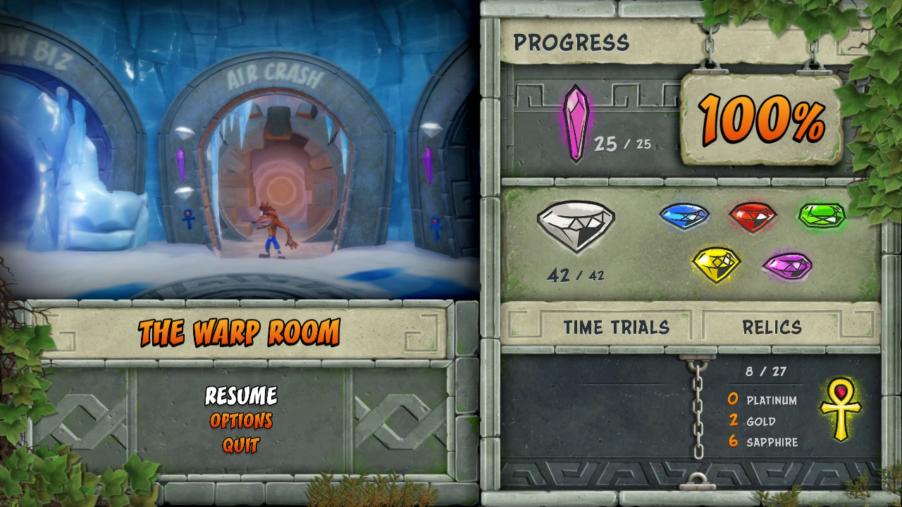
    
Crash Bandicoot 2: Cortex Strikes Back

    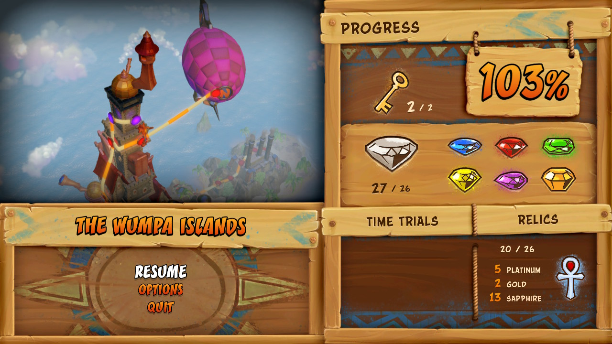
    
Crash Bandicoot

    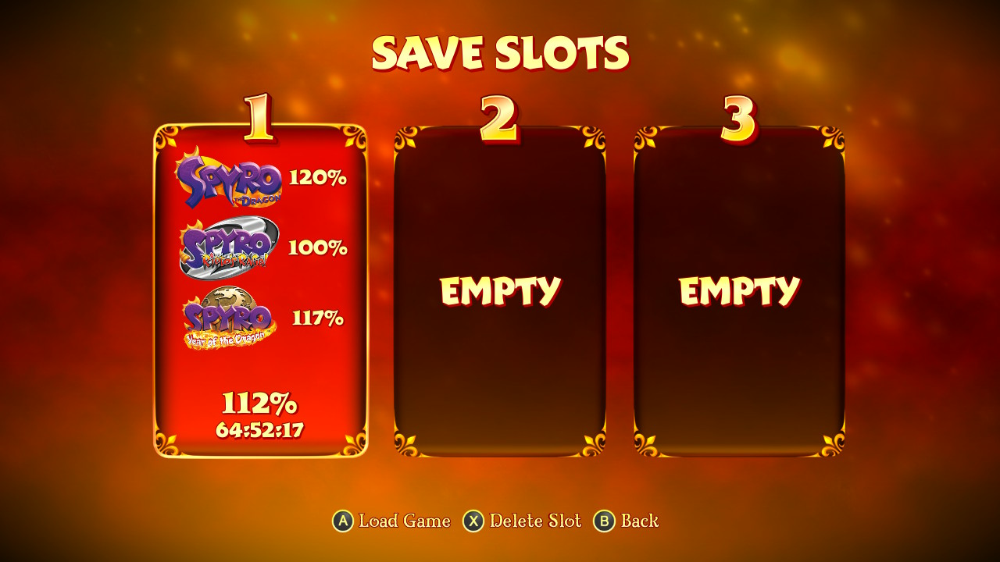
    
Spyro Reignited Trilogy

    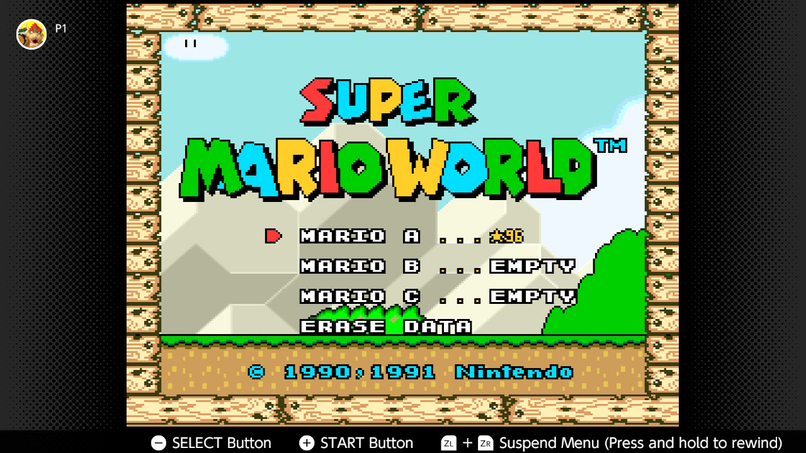
    
Super Mario World

    

    <button class="prev" onclick="moveCarousel('carousel2', -1)">&#10094;</button>
    <button class="next" onclick="moveCarousel('carousel2', 1)">&#10095;</button>
  

  <h2 align="center">Action-Adventure Games</h2>
  

    

    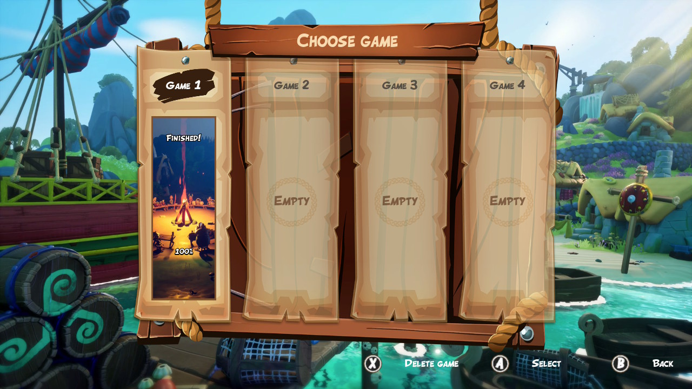
    
Asterix & Obelix XXXL: The Ram From Hibernia

    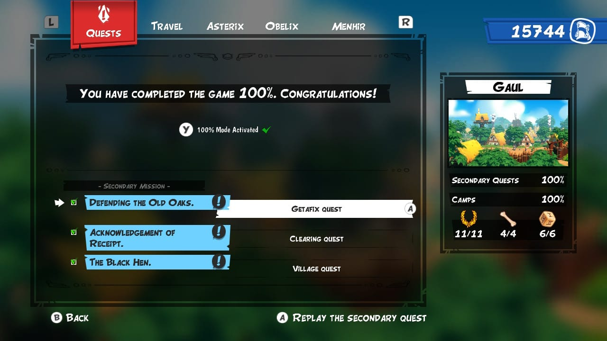
    
Asterix & Obelix XXL 3: The Crystal Menhir

    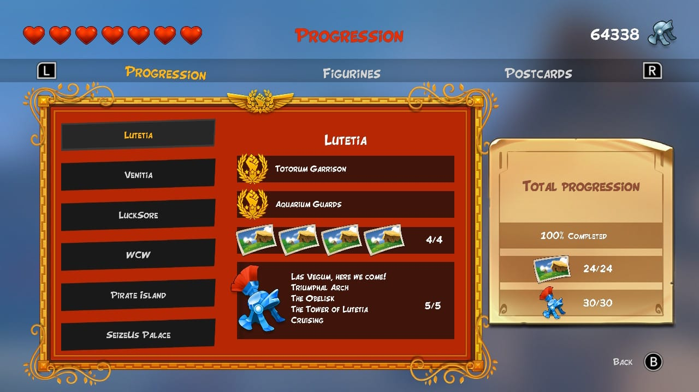
    
Asterix & Obelix XXL 2: Mission Las Vegum

    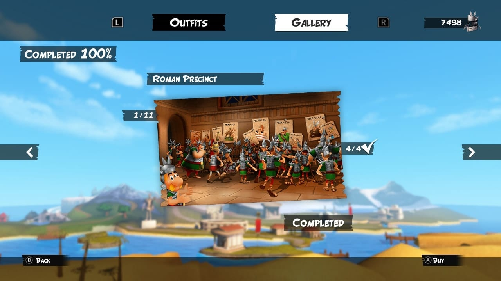
    
Asterix & Obelix XXL

    

    <button class="prev" onclick="moveCarousel('carousel3', -1)">&#10094;</button>
    <button class="next" onclick="moveCarousel('carousel3', 1)">&#10095;</button>
  

